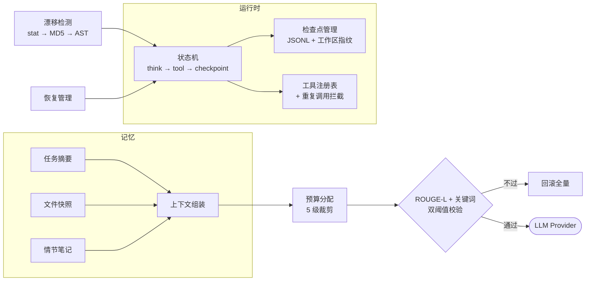

# Tether

编码 Agent 一跑就是几个小时，上下文越滚越大。业界现在的标准做法是压缩（compaction），但压缩有个很常见的翻车方式：压完之后 Agent 忘了“做到什么算完成”，只对着眼前看得见的测试反复打补丁，最后报告一个假完成。

Tether 是围绕这个问题做的长时 Agent 运行时。它管三件事：上下文压得下来、记忆不串味、中断能接着跑。实现上是一条能单独测试的组件流水线——工具循环、三层记忆、预算化压缩、文件漂移检测、恢复、重复调用拦截、MCP 接入。

先把定位说清楚：Tether 不比压缩率。学习式压缩器（LLMLingua 这类）能压到 10–20 倍，Tether 只有 22.5%。它卖的是可验证：每次压缩都要过语义相似度和关键信息两道校验，不达标就整条回滚。要么保真，要么不压。下面所有 benchmark 量的都是这个取舍。

还有一点很重要——压缩造成假完成，靠改 prompt 是治不好的。Tether 的做法是结构性的：任务摘要和模型自己维护的计划（`update_plan`）放在永不裁剪的记忆层，每轮都回到上下文；压缩有校验；文件漂移跨重启检测（stat → MD5 → AST），恢复时知道 Agent 离开期间发生了什么。

## 架构



| 阶段 | 组件 | 做什么 |
|---|---|---|
| 1 | `runtime/` `checkpoint/` | 异步状态机、JSONL 检查点、工具超时熔断 |
| 2–3 | `memory/` `context/` | 三层记忆（任务摘要 / 文件快照 / 情节笔记）+ 预算内上下文组装 |
| 4 | `context/validator.py` | ROUGE-L + 关键词校验，不过就回滚 |
| 5 | `filesystem/drift.py` | 三级文件漂移检测（stat → MD5 → AST） |
| 6 | `checkpoint/recovery.py` | 10 种中断场景的恢复规划，删掉的文件支持内容还原 |
| 7 | `tools/` | 工具注册表 + 5 秒窗口重复调用拦截 |
| 8 | `benchmarks/` | 7 个实验，含基线、消融和 Agent 级集成 |
| 9 | `llm/` | OpenAI 兼容 provider（实测 DeepSeek）+ 离线 mock |
| 10 | `runtime/runtime.py` | LLM 驱动的循环：组装 → 工具调用 → done 信号 |
| 11 | `mcp.py` `tools/builtin` | MCP 客户端（stdio JSON-RPC，零依赖）+ `update_plan` |

## 跑起来

```bash
git clone https://github.com/223456png/tether.git
cd tether
pip install -e ".[dev]"
python -m pytest tests/ -q          # 150 个测试，全离线
```

不用 API key 也能跑一个任务（会降级到离线 mock 大脑），然后把事件流转成一页报告：

```bash
tether run --goal "Create hello.txt containing 'hi' and verify it" --workspace ./ws
tether report --events ./ws/logs/events.jsonl
```

mock 大脑会真的去执行：写入、读回验证、结束，报告末尾给出结论。执行不了的目标，它只跑一段短 demo 并明说“没有追求该目标”，不会假装完成。

接任意 MCP server 的工具：

```bash
tether run --goal "..." --workspace ./ws --mcp-cmd "python path/to/mcp_server.py"
```

真实使用的安全护栏：`--require-approval` 让写类工具先人工确认；`--max-tokens N` 设硬成本上限，到量即停，状态是 STOPPED，检查点已经存好。

跑离线 benchmark：

```bash
python scripts/run_benchmark.py --all
python scripts/run_benchmark.py --experiment compression --num-samples 5
```

### 用代码驱动一个 Agent 任务

```python
import asyncio
from pathlib import Path

from tether.llm.factory import create_provider_from_env
from tether.runtime.runtime import TetherRuntime

# 有 DEEPSEEK_API_KEY（或 TETHER_LLM_*）就走真实 provider；
# 没有就离线 MockProvider（is_mock=True），这段代码永远能跑。
provider, is_mock = create_provider_from_env()

runtime = TetherRuntime(
    goal="Create hello.txt containing 'hi' and verify it reads back",
    workspace_dir=Path("./my-workspace"),
    llm_provider=provider,
    max_steps=30,
)
asyncio.run(runtime.run())
print(runtime.state.status, runtime.state.final_answer)
print(runtime.state.total_tokens, "tokens")
```

每一轮的流程是：`ContextAssembler` 在预算内从三层记忆组装上下文，模型返回工具调用或最终答案，工具经注册表执行（带重复拦截和工作区边界检查），状态、记忆、JSONL 事件流更新，然后落检查点。

几个用起来会碰到的行为：

- **错误是观察，不是判决。** `max_consecutive_failures=N`（命令行默认 3）时，工具异常或超时会喂回工具历史，让模型换参数重试；连续 N 次才熔断。默认 0 对 mock 大脑保持严格 fail-fast，因为它本来就不会适应。
- **`run_test` 是真跑的。** 在 workspace 里起 `python -m pytest <file>`，返回通过/失败摘要，失败时把 traceback 尾部作为错误返回，Agent 能看到错在哪。
- **人审门。** 开 `--require-approval` 时，写文件、跑测试这类操作执行前暂停确认；拒绝会变成 `DENIED` 观察返回给模型。
- **硬成本上限。** `--max-tokens N` 到量停机，状态 STOPPED，检查点已保存。`--max-steps N` 撞上限同理——步数和 token 是同一种“资源耗尽”，绝不伪装成 completed。
- **模型自己维护计划。** `update_plan` 把计划写进永不裁剪的任务摘要层，压缩后还在，每轮都回到上下文。
- **流式输出。** `--stream` 把模型回答以 SSE 实时吐出来，不支持流式的 provider 照常调用。

### 复现 e2e 实验

```bash
export DEEPSEEK_API_KEY=sk-...
export TETHER_LLM_MODEL=deepseek-v4-flash
python scripts/run_benchmark.py --experiment e2e --num-samples 20
```

没有 key 时降级到离线 MockProvider，结果都会打上 `is_mock: true`，CI 里零成本可跑。

## Benchmark 结果

下面所有数字都是仓库里代码跑出来的。六个离线实验用 `python scripts/run_benchmark.py --all` 复现，固定种子、可逐字节再生成；真实 LLM 的 e2e 要 API key，只提交了 Markdown 报告。各实验报告在 `src/tether/benchmarks/results/`。

先说明这些数字量的是什么：压缩、记忆、漂移、恢复、拦截几个实验直接驱动**组件**，离线、固定种子、可复现；实验 7 用确定性策略驱动**真实的运行时循环**，补上了“组件各自通过、合起来翻车”这个缺口；模型智能只由 e2e 实验量。

### 1. 上下文压缩（20 个 HumanEval 任务）

| 策略 | Prompt tokens | 信息保全 |
|---|---|---|
| 全量上下文（基线） | 681 | 100% |
| Last-N 截断 | 537（−21%） | 65%，早期工具结果被丢 |
| 预算分配（本方案） | 503（−22.5%） | 100%，过校验，失败回滚 |

### 2. 真实 LLM 端到端 pass@1（20 任务 × 3 组，DeepSeek，greedy）

| 组 | pass@1 | 平均 prompt tokens | 平均总 tokens | 平均延迟 |
|---|---|---|---|---|
| 全量上下文 | 65%（13/20） | 795 | 4548 | 77.2s |
| Last-N | 80%（16/20） | 673 | 2760 | 49.0s |
| 预算分配（本方案） | 80%（16/20） | 708（−11%） | 3609（−21%） | 62.3s |

n=20 时 pass@1 的差异在噪声内，但压缩组从不比全量差，总 token 省 21%，方向和“短上下文减少推理分心”一致。多数没通过的不是代码写错，是轻量 flash 模型在 8192 token 上限处推理预算耗尽、输出为空。

### 3. 记忆消融（20 任务）

| 记忆配置 | 平均磁盘读/任务 | 过期读 | 任务成功率 |
|---|---|---|---|
| 无记忆 | 30 | 0 | 100%（但慢） |
| 平铺缓存 | 1 | 15.95 | 45%，过期数据导致失败 |
| 三层记忆（本方案） | 2 | 0 | 100% |

平铺缓存看着只读 1 次、很省，但缓存不失效，过期读把成功率打到 45%。记忆层买的是正确性，不是省 IO。

### 4. 文件漂移检测（10 类变更 × 10 样本）

100/100 准确，0 误报 0 漏报，平均 1.3ms/文件。覆盖内容编辑、注释空白变更、追加、删除、重命名、函数增删改、签名变更、并发多文件编辑。

### 5. 恢复（10 个中断场景 × 5 轮）

整体 100% 恢复，平均丢 0.6 步。删掉的文件也能救：Agent 读或写过的文件都有内容快照，可以写回；没碰过的文件没有快照，恢复不了——检测器照样标记，恢复失败时给出明确原因。

### 6. 重复调用拦截（20 个模拟任务）

5 秒窗口内 60/60 次重复调用全部拦下，省了 5100 token 的冗余工具输出。

### 7. Agent 级集成评测（20 个脚本任务 × 5 类，离线）

用确定性的目标导向策略代替 LLM，驱动真实的运行时循环跑合成文件操作任务，按最终工作区状态判分。

| 任务类型 | 结果 |
|---|---|
| 创建并验证 | 4/4 |
| 编辑已有文件 | 4/4 |
| 搜索后修复（看观察再反应） | 4/4 |
| 计划执行（`update_plan`） | 4/4 |
| 测试并汇报（真跑 pytest） | 4/4 |
| 合计 | 100%（20/20），平均 3.4 步/任务 |

这个实验首跑就抓到一个真 bug：多行工具输出在观察通道被截断。这也是做集成评测的意义。

## 局限（看数字之前先看这里）

- e2e 只有 20 任务 × 3 组。15 个百分点以内的差异都在噪声里，我只按方向一致来报，不当显著。
- benchmark 驱动的是组件，不是整合后的循环（见上面“数字量的是什么”）。
- 代码执行没有沙箱。测试跑在带超时的普通子进程里，工具限制在工作区内，但循环本身不是安全边界。
- `file_deleted` 恢复只覆盖碰过的文件，没碰过的恢复不了。
- 漂移测试集是自建的（10 类变更 × 10 样本），100% 说的是这十类全覆盖，不代表生产泛化。
- HumanEval 子集是本仓库内置的 20 题，因为构建环境访问不了上游仓库。
- 压缩率 22.5%，比不上学习式压缩器的 10–20 倍；换来的是每次压缩都有硬校验。校验是 CJK-aware 的：`rouge_score` 把中文全当分隔符（纯中文恒 0 分、混合文本丢中文不扣分），所以中文走字符级 LCS 组合评分，中文上下文同样可验证。

## Roadmap

- 沙箱化执行：测试跑进容器，把“不是安全边界”变成真的保证。
- 跨任务情节记忆：笔记目前是任务内的，共享存储能让经验跨任务传递。
- 对话压缩：工具历史现在是窗口化，摘要能把回忆视野拉长。

已经做完的：

- 分节预算上限 + 头尾截断（压缩 −22.5%，校验 100% 通过）
- checkpoint 压缩，JSONL 历史有界
- MCP 客户端，任意 server 的工具进注册表
- `update_plan`，模型在记忆里维护计划
- 审批门 + token 预算
- SSE 流式全链路
- Agent 级集成评测（20/20）

## 项目结构

```text
src/tether/
├── runtime/        # 状态机 + LLM/mock 循环 + JSONL 事件流
├── checkpoint/     # 检查点 + 智能恢复
├── memory/         # 任务摘要 / 文件快照 / 情节笔记
├── context/        # 预算分配 + ROUGE-L 校验
├── filesystem/     # 漂移检测（stat → MD5 → AST）
├── tools/          # 工具注册表 + 拦截器 + 真实 run_test
├── llm/            # OpenAI 兼容 provider + 离线 mock
├── mcp.py          # MCP 客户端（stdio JSON-RPC）
├── reporting.py    # 事件流 → 单页报告
├── cli.py          # tether run / tether report
└── benchmarks/     # 7 个实验、指标、报告
tests/              # 150 个测试，全离线
```

## License

MIT，见 [LICENSE](LICENSE)。
